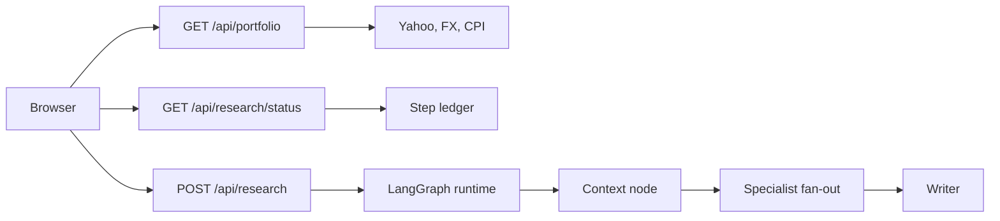
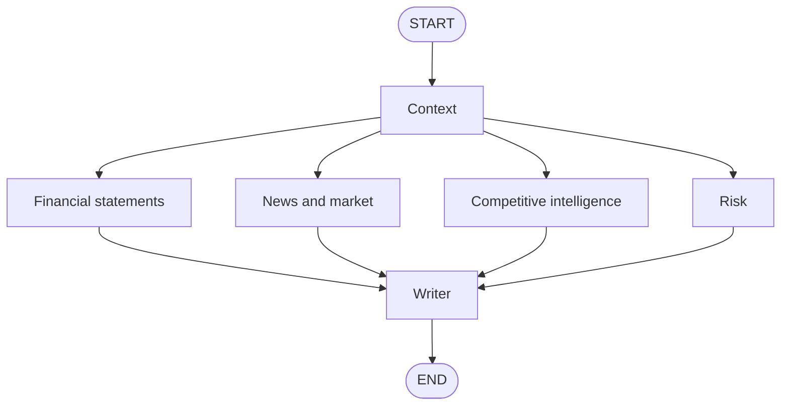
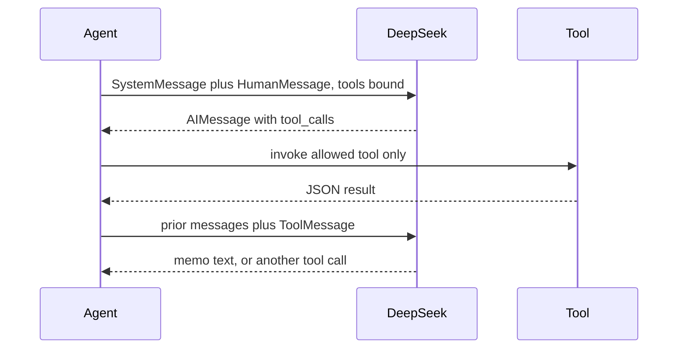

# Agentic Portfolio Watcher

A technical design for a local portfolio dashboard whose research path is a multi-agent system. The price screens are deterministic. The research screen is a LangGraph orchestration over LangChain agents, built to show how a small team of models can be wired, constrained, and observed.

The public repository ships a fictional sample portfolio of about $1,000,000 at late-October 2026 prices. That file is not a real person's book, and it is not a recommendation. A private CSV can replace it on one machine without entering git.

## Problem

A personal portfolio is easy to look at and hard to judge. A CSV of shares, a live price, and a weight do not say whether a single name has become too large, whether a drop has a cause, or whether the honest move is to sell part of the position or to leave it alone. ETFs make that worse: the size of a stock is the direct line plus whatever the funds already hold.

Doing that by hand means opening a quote page, a news feed, a peer list, and a spreadsheet, then writing the conclusion yourself. Asking one chat model to "look at my portfolio" is worse. The model will invent a P/E, skip a specialist, and has no way to show which step produced which sentence.

Agentic Portfolio Watcher splits those jobs.

- The dashboard computes value, weights, look-through, stress, and the long-range illustration in Python. The model never does that arithmetic.
- A fixed agent team runs only when asked, and only on a few direct stocks that a rule has already flagged.
- Each specialist may call only its own tools, and may cite only what those tools returned.
- A writer, who cannot search and cannot see Yahoo, turns the four memos into one note that ends with a suggestion: sell a stated share of this holding, or do nothing.

The thing being demonstrated is the orchestration: parallel specialists, a writer that starts only after they finish, tool schemas with hard call caps, short-term graph memory, a long-term memo file, and a UI that shows which agent is working.

## Design

The process hosts two isolated control planes. The valuation plane is deterministic and idempotent under a sixty-second cache. The research plane is an on-demand directed graph. A portfolio refresh never constructs a chat client, so market data and model inference cannot be conflated.



`app.py` is a `ThreadingHTTPServer` bound to `127.0.0.1:8765`. It does not import LangChain. The research route delegates to `research.graph.handle_request`, which is the sole ingress into the agent runtime.

| Piece | Choice | Why |
| --- | --- | --- |
| Prices and weights | Python over Yahoo chart and quote-summary JSON | Numbers have a source. A missing field stays missing. |
| Who is researched | `research/flags.py`, at most three direct stocks | The model does not decide the universe. ETFs and crypto are context, not targets. |
| Agent runtime | LangChain messages and `@tool` | Tool calls, refusals, and the message list are explicit. |
| Order of agents | LangGraph `StateGraph` with fixed edges | A specialist cannot be skipped, and cannot read another specialist's memo. |
| Model | `ChatDeepSeek`, `deepseek-flash`, thinking off, temperature 0 | One cheap model for every role. Tool-calling turns stay on the non-thinking path. |
| Writer output | One memo plus up to two chart specs | The page renders the memo. The model does not emit HTML or SVG. |
| Secrets | Environment, gitignored `.env`, or gitignored `secrets/deepseek.md` | The key is not in source, the sample CSV, or this document. |

Flag rule, all of it in code: look-through weight above 8%, or a top-three direct stock, or a price within 5% of the three-month high, or a three-month rise above 25%.

## Orchestration

The orchestration is the artifact this repository is meant to exhibit: a closed topology, not a supervisor model improvising the next worker.

LangChain is the intra-agent substrate: messages, tool schemas, and the invocation loop. LangGraph is the inter-agent topology. There is no `create_agent` and no router LLM. Admission to the writer is a structural fan-in. A specialist that has not finished cannot be bypassed, and no specialist can read a peer memo, because those fields are not in its input.



`ResearchState` is a `TypedDict`. Memo fields are plain strings. `trace` is `Annotated[list, operator.add]`, so the four parallel nodes append to the trace instead of overwriting it. The writer edge is a fan-in:

```python
graph.add_edge(["financial", "news", "competitive", "risk"], "writer")
```

The compiled graph uses a process-local `InMemorySaver`. Each symbol run is invoked with `thread_id` `{symbol}-{run_id}`. That checkpoint is the short-term memory of one run. It dies with the process. The note the next run should remember is stored separately, in gitignored `data/research_memory.json`, and is pasted into the writer's human message.

### The tool loop

`run_agent` is six turns, and it is the whole LangChain agent:



1. `model.bind_tools(tools)` publishes only that role's list. The writer cannot see `search_web`. Binding is what makes the schema exist. The prompt is not the enforcement.
2. The first request is one `SystemMessage` and one `HumanMessage`.
3. `invoke` returns an `AIMessage`. No `tool_calls` means that text is the memo.
4. Each call runs `tool.invoke(args)`. A name outside the allowed map is not executed. The tool result is `{"error": "... is not available to this agent.", "refused": true}`.
5. The result is appended as a `ToolMessage` whose `tool_call_id` matches the call, and the model is invoked again.

Specialists are told not to recommend a trade and not to cite a figure the tool omitted. Only the writer recommends.

| Node | Calls a model | Tools | What it is given |
| --- | --- | --- | --- |
| `context` | No | None | Builds the position JSON from the payload already on the page. |
| `financial` | Yes | `get_fundamentals` | That JSON. |
| `news` | Yes | `get_headlines`, plus `search_web` only when the preview has fewer than two headlines | That JSON and the headlines Python already fetched. |
| `competitive` | Yes | `get_peers` | That JSON. |
| `risk` | Yes | `get_position_risk` | That JSON. |
| `writer` | Yes | `chart_series`, at most twice | The prior memo, the position JSON, and the four memos. No Yahoo handle and no search tool. |

The position JSON is symbol, name, shares, price, direct weight, look-through weight, three-month change, industry, flag reasons, and the prior memo if one exists.

While `POST /api/research` is open, the page polls `GET /api/research/status` about every 700ms. Each node sets its own step to `working` and then `done` under a lock, so the four specialists can show as working together. The list clears when the symbol run ends. The dialog then shows the writer note only.

### Tool contract

Tools live in `research/tools.py`. The docstring is the description on the schema the model sees. A `contextvars` scope (`start_run` / `bind_run`) gives the tool the current symbol and the call counters. The model does not pass the cap.

| Tool | Contract | Cap |
| --- | --- | --- |
| `get_fundamentals` | Trailing P/E, profit margin, revenue growth, debt-to-equity, only when Yahoo's quote summary had them. Absent keys are omitted. | Financials |
| `get_headlines` | Yahoo Finance RSS for that symbol. An empty list is not "no news." | News |
| `search_web` | Titles, URLs, snippets. Tavily basic search (1 credit) when `TAVILY_API_KEY` is set. Otherwise the DuckDuckGo Instant Answer API, labeled as an instant answer. Empty stays empty. No HTML scrape, no extract, no crawl. | 2 calls per symbol per run, in code |
| `get_peers` | Yahoo related symbols, each marked if the portfolio already holds it. One `search_web` call only if that list is empty. | Competition |
| `get_position_risk` | Direct weight, look-through weight, rank, value, and the dollar loss at a 20% drop. Same shock as the Drawdown risk row. | Risk |
| `chart_series` | A spec, not a picture: title, dates, closes, markers for the last price and the window high. Range is `3m`, `1y`, or `5y`, cut from history `fetch_symbol` already stored. `compare=portfolio` attaches the portfolio series. The existing line chart draws it, so the currency switch relabels the axis. | 2 calls, writer only |

### What the writer must conclude

The writer covers what looks stretched, what would have to change to justify selling, what argues against selling, and what is unknown. It then ends with a **Suggestion**: a percent of the current shares and a share count to sell, or an explicit decision to do nothing, with a reason. It may not invent a figure the memos did not contain.

## Portfolio engine

The agent sits on top of a normal market-data pipeline. That pipeline is what keeps the model from doing arithmetic.

Yahoo requests use a session cookie from `https://fc.yahoo.com` and a crumb from `v1/test/getcrumb`. Daily history is `v8/finance/chart` with `range=5y` and `interval=1d`. Profile, dividend, and ETF constituents are `v10/finance/quoteSummary` (`assetProfile`, `fundProfile`, `topHoldings`, `summaryDetail`, `defaultKeyStatistics`). `holdingPercent` is a fraction. Quotes cache for about 60 seconds. The last point of the value series is replaced with the live total.

| Screen | Computation |
| --- | --- |
| Summary | Market value, day move, window move, holding count, monthly dividend of stocks and ETFs. Crypto is left out of income. |
| Value | 7, 30, or 92 days of combined value. |
| Drawdown risk | One total. Equities −20%, crypto −50%, gold unchanged. |
| Allocation | Treemap sized by weight, colored by today's move. |
| ETF and industry | ETF versus the rest, ETF region, industries excluding ETFs. |
| News | Two RSS items per direct stock, deduped, capped at 24. |
| Holdings | Symbol, type, industry, shares, price, day move, value, weight. |
| Look-through | Direct shares plus the ETF's published top 10. The rest of the fund is "Other holdings inside ETFs." |
| Outlook | Each name's 5-year CAGR is pulled 15% of the way toward 6% and clamped to −10%..+12%. Under one year of history, the rate is 6%. The path is then deflated by that currency's average World Bank CPI. An illustration, not a forecast. |

**SGD**, **CAD**, and **RMB** multiply USD figures by the latest Yahoo rate (foreign currency per 1 USD) and do not refetch prices.

## Run it

Python 3.10 or newer, plus a network path to Yahoo.

```bash
python3 -m pip install -r requirements.txt
python3 app.py
```

Open [http://127.0.0.1:8765/](http://127.0.0.1:8765/). On a Mac, **Portfolio Tracker.app** in this folder launches the same server. Leave the app in the project directory. If Gatekeeper blocks it, right-click, choose **Open**, and confirm. Failures land in `tracker.log`.

The key is read in this order, and the first hit wins. None of these files are in git.

1. `DEEPSEEK_API_KEY` in the environment.
2. A `.env` file beside `app.py`. `load_env` uses `setdefault`, so it will not override the environment.
3. `secrets/deepseek.md`. Used only when the variable is still empty. The loader takes the first non-empty line that is not a heading and not the gitignore note.

`TAVILY_API_KEY` is optional. Without it, `search_web` uses the DuckDuckGo instant answer. `.env.example` lists the names and nothing else.

Holdings columns are `asset_type` (`stock` or `crypto`), `symbol`, `shares`, and optional `cost_per_share`. ETFs are entered as stocks. Yahoo marks them as ETFs. Crypto tickers are priced as `SYMBOL-USD`. If any `data/*.local.csv` exists, those files are the book and the sample is not loaded. Duplicate symbols have their shares summed.

```csv
asset_type,symbol,shares
stock,AAPL,10
stock,VOO,25
crypto,ETH,1.5
```

```text
app.py                 HTTP server, Yahoo client, portfolio payload
static/index.html      dashboard, agent status list, report dialog
research/graph.py      StateGraph, checkpointer, live step list
research/agents.py     ChatDeepSeek, prompts, bind_tools loop, key loader
research/tools.py      six tools and the per-run caps
research/flags.py      who is eligible for a run
research/memory.py     previous writer memos
tests/test_research.py fake-model proof of the graph and the caps
data/holdings.csv      fictional sample
```

Tests do not call DeepSeek. `MODEL_OVERRIDE` injects a fake chat model with `bind_tools` and `invoke`. They check flag selection, that the writer runs after the four specialists and cannot search, that the third search call and the third chart call are refused, that the prior memo is handed to the writer, and that a missing key fails the research route without taking down the portfolio route.

```bash
python3 -m unittest tests.test_research -v
```

Market data can be missing, delayed, or wrong. The stress case, the look-through, and the long-range path are illustrations. The suggestion is the writer's synthesis of the tool results. It is not an order.
